[Portfolio](https://levanrd.vercel.app/) · [Email](mailto:lesterivan.dalaguit@gmail.com)

## Contribution snake

<picture>
  <source media="(prefers-color-scheme: dark)" srcset="https://raw.githubusercontent.com/Levanrd/Levanrd/output/contribution-snake-dark.svg">
  <source media="(prefers-color-scheme: light)" srcset="https://raw.githubusercontent.com/Levanrd/Levanrd/output/contribution-snake.svg">
  
</picture>
